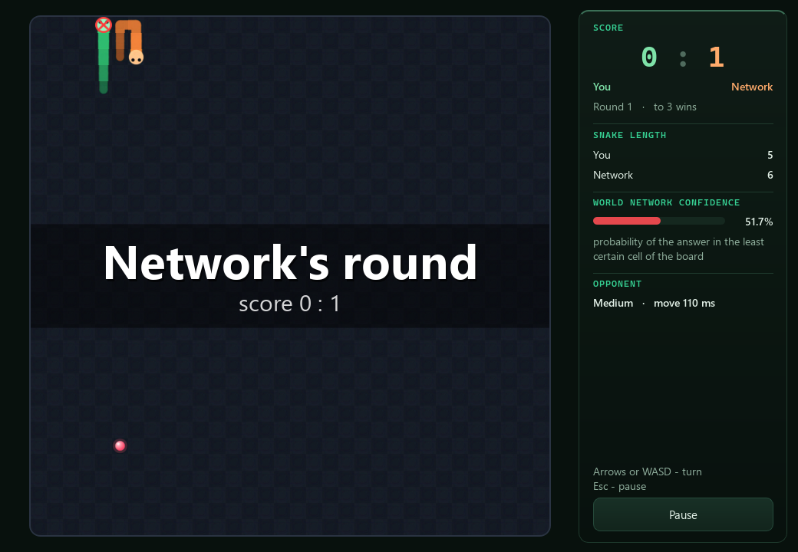
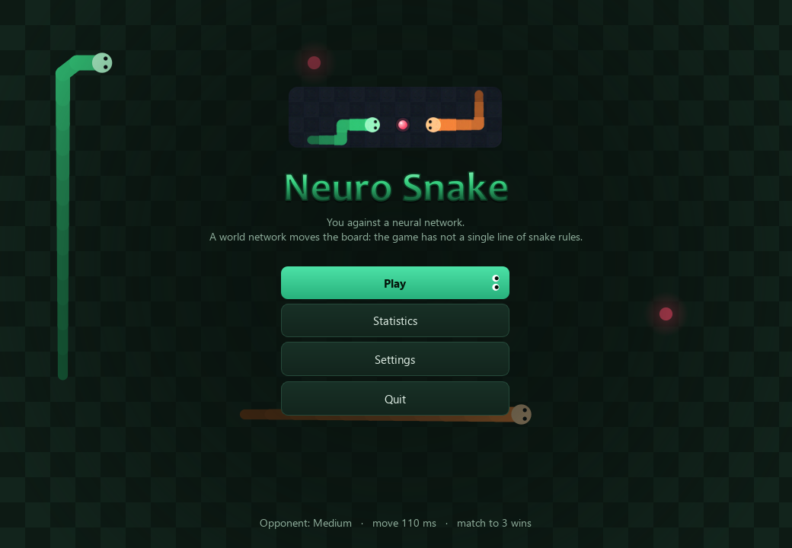
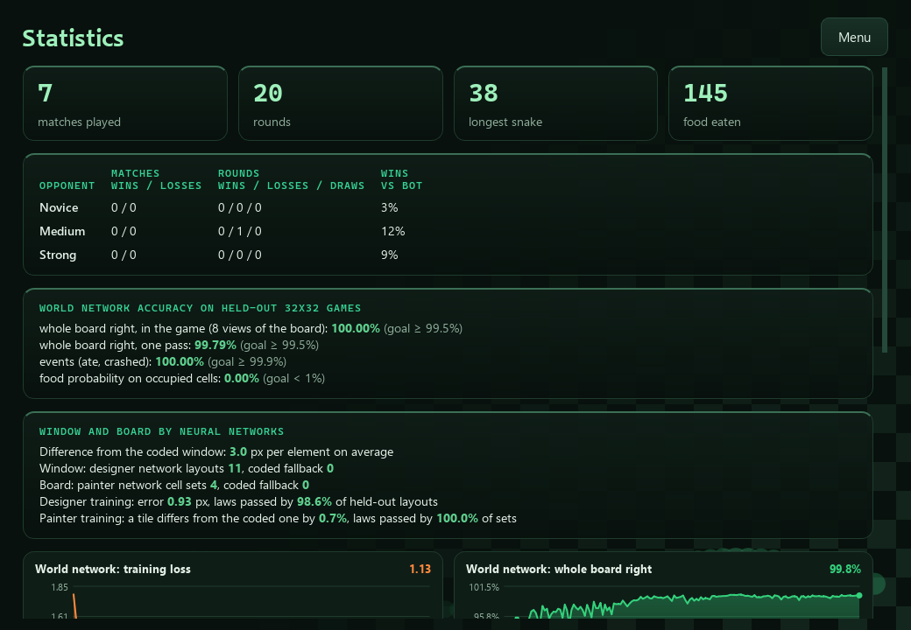

<div align="center">

# Neuro Snake

**Two-player snake with not a single line of snake rules: the world is moved by a convolutional network of its own, a second network plays against you, and since 2.0 a third one lays out the window and a fourth paints the board cells.**

[Download for Windows](https://github.com/ALEXalesha/SnakeAi/releases/latest) &nbsp;·&nbsp; [Русская версия этого файла](README.ru.md)

[](https://github.com/ALEXalesha/SnakeAi/actions/workflows/ci.yml)
[](https://github.com/ALEXalesha/SnakeAi/releases/latest)
[](LICENSE)



</div>

[](https://claude.com/claude-code)
Code, tests and docs are written by Claude (Anthropic) in Claude Code. Ideas, testing and decisions - Alexey.

> **The interface speaks English and Russian** (Settings → Language, switches on the fly), with a dark and a light theme. The long write-up is in Russian - [README.ru.md](README.ru.md), which this file summarises.

A 32x32 field, two snakes: green is yours (arrows or WASD), orange is a neural network. Hit a wall, a body or the other head and the round is over; the survivor scores, first to three wins.

The point is invisible. A normal snake game has code that moves the head, checks the walls, grows the tail after eating and drops new food. **This one has none of it.** Every tick the game hands the old field and both key presses to a *world network*, and the network returns the new field: where the snakes moved, who ate, who crashed and where the next food appears. The game only draws what the network said, keeps score and reads keys.

## The world network

Each cell is one of 12 classes. A body cell stores not "how many ticks it has left" but a **pointer to the neighbour closer to the head**, which makes every rule local: the tail is the body cell nobody points to, the neck points at the head and gives the heading, and the snake's length never enters the rules, so a network trained on short snakes carries a hundred-cell one just as well.

Three 3x3 convolutions (a 7x7 view around every cell) plus one long-range link, a global max over the field, which exists for a single rule: "the snake ate, so its tail stays", where the eating happens at the head and the tail may be across the field. Separate outputs give each cell's class, four events (who ate, who crashed) and a map of where food will appear; the new food is drawn from it. Field size is not baked in.

The rules live only in a *teacher* (`game/teacher/`, plain code) used while training: it plays bot games and grows random snakes to make examples. Training ran on 8-16 cell fields (a convolution on 12x12 is seven times cheaper than on 32x32) mixed with 32x32 ones, on hand-written numpy layers. A single pass on held-out 32x32 fields matches the teacher cell for cell on 99.8% of moves - one slip per 500 moves, and a slip leaves a stray piece of snake on the field for good. So in the game the network looks at the field eight times, in four rotations and two mirror images in one batch, and adds the answers back in place: snake rules do not change under rotation (a test checks this on the teacher), the network's rare slips do not repeat across views, and the result is **100% of moves** on the same fields at 22 ms per move. Still only the network - just a permutation of cells and direction names. The teacher is not in the build, and a test checks the sources that neither the game nor the world network imports it.

## The opponent

It sees a 15x15 window around its head, the direction to the nearest food and its own heading; a dense network 906 -> 128 -> 64 -> 4 picks the direction. No "don't hit the wall" check exists in the game. It learned first by imitating a path-finding bot (96.6% agreement), then by REINFORCE against that bot, kept only if it loses no more often.

| Level | vs bot: wins / losses / draws | vs a random snake |
|---|---|---|
| novice (early imitation snapshot) | 3% / 74% / 23% | 99% wins |
| medium (imitation) | 12% / 40% / 48% | 100% |
| strong (after reinforcement) | 9% / 29% / 62% | 100% |

## The window and the board are made by networks (2.0)

The widgets are still real Qt widgets (everything clicks, keys and focus as before), but where they stand and how they look is decided by a **designer network** (dense 16 -> 384 -> 384 -> 69): from the screen, window size, theme, language, what optional items are visible and four noise numbers it outputs a rectangle for every element and the window style (font scale, corner radius, five accent colours). Each board cell is painted by a **painter network** (21 -> 384 -> 384 -> 1728) as a 24x24 RGB tile from a cell key (what is in the cell, whose snake, which neighbours it links to, how far from the tail, checker parity, crash), the palette and noise. Both learned from the code of 1.x, which follows the same noise with its own knobs (margins, spacing, font, radius, accent hue; stroke width, head, eyes, food size) - so every launch the window is almost the same, never identical.

The answer is checked by laws (`game/design/laws.py`): everything inside the window and its parent, no overlaps, enough room for the text, buttons at least 28 px high, the board square at least 320 px, readable contrast (WCAG 4.5 / 3); every painted tile must look more like a coded tile of its own kind than of another and differ from it by at most 4%. On failure the game tries up to three new noises, then falls back to the code, silently logs it in `ai_ui.json`, and the Statistics screen shows how often that happened and how far the window is from the coded one on average.

On 1200 held-out layouts the designer is off by 0.93 px on average and 98.6% pass the laws (since the terrarium look of 2.1 the window scale is one of its inputs; 2.0 had 0.67 px and 99.8% without scaling); in 240 launches of 2.0 the fallback was never needed. The first designer passed only 78% at the same mean error, because the code packs elements tight to their minimum size and a 2 px undershoot clips text: it now trains on rectangles with 1 px of room on each side and an 8x penalty for undersized width and height, settings hints keep room for three lines (their height used to jump with every extra wrapped line), the font is one of five sizes instead of a continuous knob, and training covers windows up to 4K. Painted tiles differ from the coded ones by 0.73% on average (worst 2.3%); all 30 held-out sets pass. Board frames redraw only cells whose key changed and are no slower than in 1.1 (a test).

## The window

 

Qt (PySide6): menu, match with a 3-2-1 countdown and pause, statistics with the training curves of all four networks, settings in two cards across the whole window (speed, opponent level, food-map overlay; volume, theme, language, three board palettes), synthesized sounds, and the window reopens where it was closed.

## Running

Download `SnakeAIGame-<version>-portable.zip` or `-setup.exe` from the [releases](https://github.com/ALEXalesha/SnakeAi/releases/latest), or from source with Python 3.13:

```
pip install -r requirements.txt
python main.py
```

Retrain with `python -m game.train.world_train`, `python -m game.train.player_train`, `python -m game.train.paint_train` and `python -m game.train.design_train`; build with `python build.py`.

## Part of AiGameRoom

Since 1.1.0 the game follows the [PythonAiGames contract](https://github.com/ALEXalesha/AiGameRoom): everything game-specific lives in `game/` (`core/` field encoding, start and match, `ai/` the world and opponent networks, `ui/` the Qt widget, `teacher/` and `train/` for training only, `models/` trained weights), and `game/__init__.py` exports `GAME_INFO` and `create_widget(ctx)`. The game has no main window of its own: `python main.py` puts the widget into a standalone window (`aikit.make_window`, same size and Quit button as before), and the AiGameRoom shell puts the very same widget into a tab. Theme, language and volume come from `ctx` and change on the fly; files are written only to `ctx.data_dir` (`%APPDATA%\SnakeAIGame\snake` for the standalone game). Settings and statistics of 1.0.x (`%LOCALAPPDATA%\SnakeAIGame`) are copied over on the first start; the old files stay. When the tab is hidden, `pause()` pauses the match; `shutdown()` stops the match timer. `aikit/` is a copy of the shared kit (numpy layers, context, standalone window, window state).

## Tests

`python -m pytest -q` - 313 tests (222 of the game and 91 of the shared `aikit` kit): every teacher rule, the trained world network against the teacher on held-out fields, long snakes and whole rounds, the opponent against the bot, the window off-screen, and the contract entry point - the widget made the way the shell makes it, theme and language switched on the fly, every screen in English with no Russian left, pause/resume/shutdown, files written only to the data folder, the 1.0.x data migration. Deliberately broken rules, gradients, key queues and eleven breakages of the widget (pause, resume, shutdown, language, theme, palette, volume, Quit) turn them red. Since 2.0 also the layout laws, the designer and painter against the code, the fallback with a garbage network, missing models, language and theme switches, 10% wider fonts and windows from 820x600 to 4K; `tools/mutate.py` breaks the laws, the fallback, the journal, the tiles and the settings layout, and every breakage is caught.

Python, numpy, PySide6. MIT licence.
