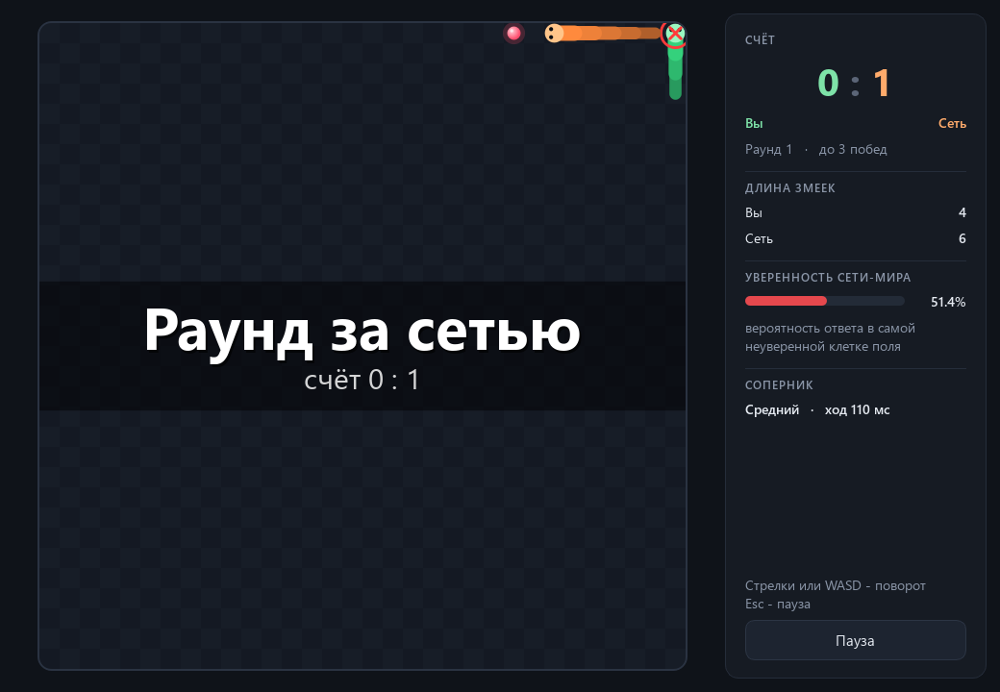
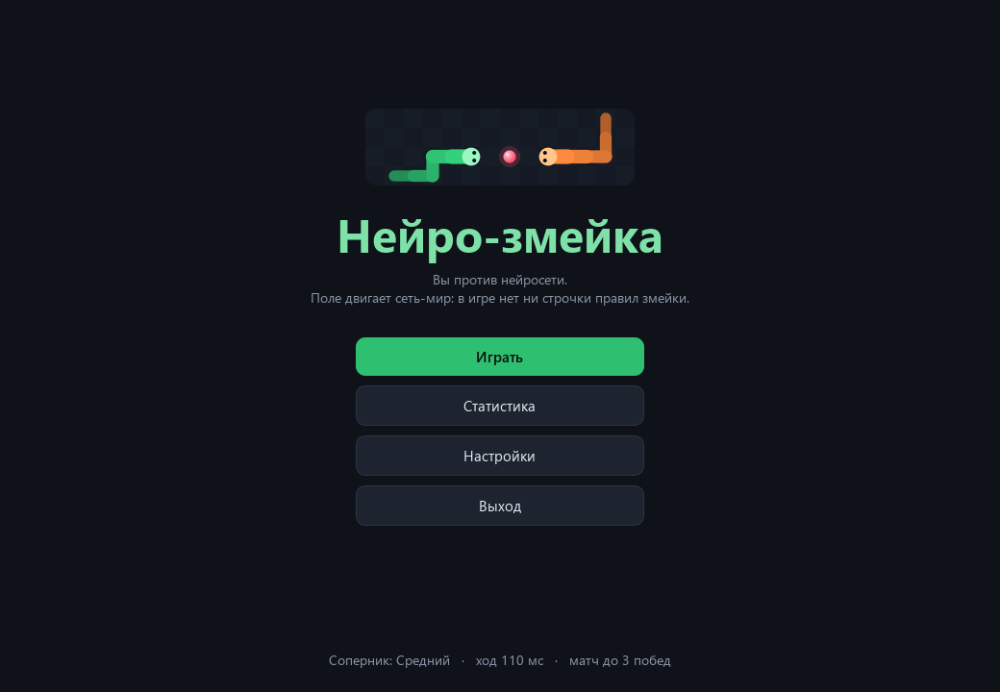
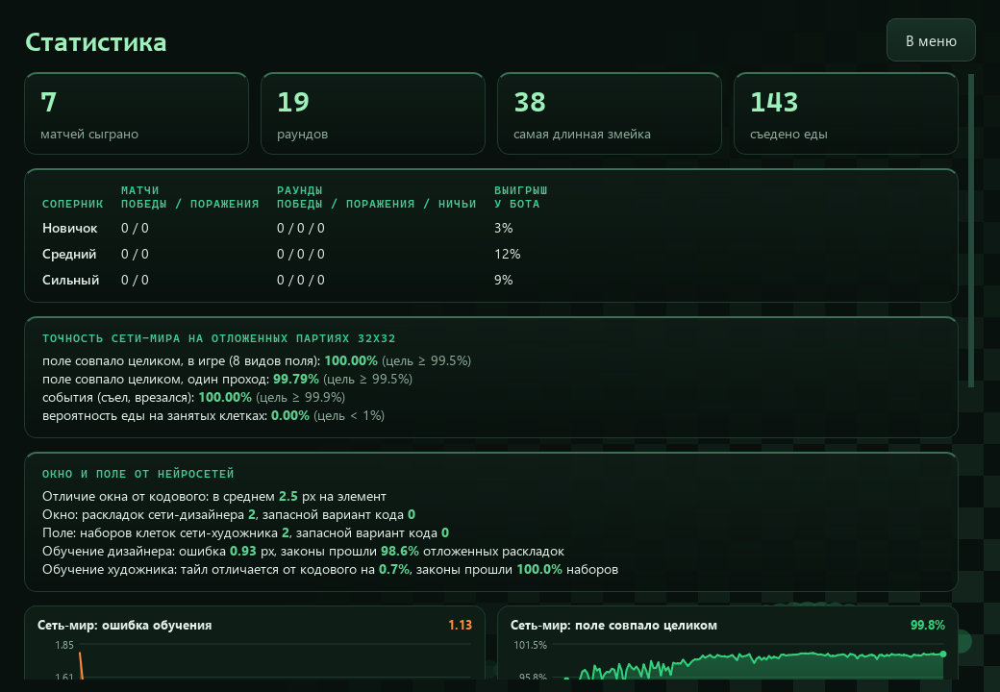

<div align="center">

# Нейро-змейка

**Змейка на двоих, в которой нет ни строчки правил змейки: мир двигает своя свёрточная нейросеть, а против вас играет вторая сеть.**

[Скачать для Windows](https://github.com/ALEXalesha/SnakeAiGame/releases/latest) &nbsp;·&nbsp; [English version of this file](README.md)

[](https://github.com/ALEXalesha/SnakeAiGame/actions/workflows/ci.yml)
[](https://github.com/ALEXalesha/SnakeAiGame/releases/latest)
[](LICENSE)



</div>

Поле 32x32, две змейки: зелёная - ваша (стрелки или WASD), оранжевая - нейросеть. Врезался
в стену, в тело или лбом в соперника - раунд окончен, выжившая змейка получает очко, матч
до трёх очков.

Главное здесь не видно глазами. В обычной змейке есть код: сдвинуть голову, проверить
стену, вырастить хвост после еды, положить новую еду. **Здесь такого кода нет.** Каждый
ход игра отдаёт нейросети-миру старое поле и два нажатия, а сеть сама выдаёт новое поле:
куда сдвинулись змейки, кто съел, кто врезался и где родится следующая еда. Игра только
рисует то, что сказала сеть, считает очки и читает клавиши.

## Две сети

### Сеть-мир

Каждая клетка поля - один из 12 классов: пусто, еда, голова и тело каждой змейки. Тело
хранит не «сколько ходов ему жить», а **указатель на соседнюю клетку ближе к голове**.
Из-за этого все правила становятся местными:

- хвост - клетка тела, на которую не указывает ни один сосед;
- шея - клетка, указывающая на голову, а значит и направление змейки;
- длина змейки правилам не нужна вовсе, и сеть, обученная на коротких змейках, так же
  ведёт змейку в сотню клеток.

Сеть - три свёртки 3x3 (поле зрения 7x7 вокруг каждой клетки) и одна дальняя связь:
глобальный максимум по полю. Он нужен ровно одному правилу - «змейка съела, и её хвост
остаётся на месте»: съедание видно у головы, а хвост может быть на другом конце поля.
Отдельные выходы: класс каждой клетки, четыре события (кто съел, кто врезался) и карта
«где родится еда», из которой новая еда и выбирается. Размер поля в сеть не зашит.

**Как училась.** Правила есть только у «учителя» - обычного кода в `teacher/`, который
живёт лишь при обучении: он играет партии ботов, выращивает случайных змеек и так даёт
примеры. Сеть училась на полях 8-16 клеток (свёртка на поле 12x12 в семь раз дешевле, чем
на 32x32) с долей полей 32x32, всё на своих слоях numpy, без PyTorch.

**Насколько точна.** Один прогон на отложенных полях 32x32 даёт поле, совпавшее с учителем
клетка в клетку, на 99,8% ходов, события - на 100%. Этого мало: одна ошибка на 500 ходов,
и на поле остаётся обрывок змейки навсегда. Поэтому в игре сеть смотрит на поле восемь
раз - в четырёх поворотах и двух отражениях, одним пакетом - и складывает ответы,
вернув их на место. Правила змейки от поворота не меняются (это проверяет тест на
учителе), а редкие ошибки сети в разных видах не совпадают и гасятся: **100% ходов** на
тех же полях, 22 мс на ход. Это по-прежнему только сеть - никаких правил, одна
перестановка клеток и названий направлений. В собранную игру учитель не входит, и тест проверяет по исходникам, что ни
игра, ни сеть-мир его не импортируют.

По дороге нашлась одна поучительная ошибка. Первое обучение застряло на 98,2%, и
половина промахов была одной и той же: у съевшей змейки сеть стирала хвост. Клетки,
которые меняются, учились с весом 20, а хвост съевшей змейки как раз не меняется - самое
редкое правило училось с весом 1. Хвостам дали вес всегда, и точность выросла за тысячу
шагов дообучения. Следующие ошибки были у клеток тела свёрнутой змейки (сеть изредка
принимала их за хвост) - им дали вес 5.

### Сеть-соперник

Видит окно 15x15 вокруг своей головы (препятствия, еда, голова соперника, своя шея),
направление на ближайшую еду и своё направление. Плотная сеть 906 -> 128 -> 64 -> 4
выбирает направление. Никакой проверки «не в стену» в игре нет: это она выучила сама.

Училась в два шага:

1. **Подражание боту.** Бот идёт к еде кратчайшим путём, обходит тупики заливкой и не лезет
   лоб в лоб. Сеть повторяет его ход в 96,6% позиций.
2. **Пробы и ошибки** (REINFORCE) против бота: награда за еду и победу, штраф за
   столкновение. Новая версия принимается, только если на проверочных раундах
   проигрывает боту не чаще прежней.

| Уровень | Против бота: победы / поражения / ничьи | Против случайной змейки |
|---|---|---|
| новичок (ранний снимок подражания) | 3% / 74% / 23% | 99% побед |
| средний (подражание) | 12% / 40% / 48% | 100% |
| сильный (после проб и ошибок) | 9% / 29% / 62% | 100% |

Сто раундов на уровень, ничья - обе врезались или раунд дошёл до 600 ходов. Бот -
сильный противник: он видит всё поле и считает пути, а сеть видит окно 15x15.

## Окно

 

- **Меню**: играть, статистика, настройки, выход.
- **Матч**: отсчёт 3-2-1, счёт, длины змеек, уверенность сети-мира (вероятность ответа
  в самой неуверенной клетке поля), пауза на Esc. По желанию поверх поля - карта «где
  сеть родила бы еду».
- **Статистика**: матчи и раунды по уровням соперника, самая длинная змейка, съедено
  еды, точность сети-мира и графики обучения обеих сетей.
- **Настройки**: скорость, уровень соперника, громкость, три палитры поля, карта еды.
- Звуки синтезируются numpy: еда, столкновение, отсчёт, победа, поражение.
- Окно открывается там, где его закрыли.

Настройки и статистика лежат в `%LOCALAPPDATA%\SnakeAIGame`; если рядом с exe лежит
`portable.txt` (как в portable-архиве) - в папке `saves` рядом.

## Запуск

**Готовая сборка:** в [релизах](https://github.com/ALEXalesha/SnakeAiGame/releases/latest)
два файла, оба ничего не требуют от системы:

- `SnakeAIGame-<версия>-portable.zip` - распаковать и запустить `SnakeAIGame.exe`;
- `SnakeAIGame-<версия>-setup.exe` - установщик без прав администратора.

**Из исходников** (Python 3.13):

```
pip install -r requirements.txt
python main.py
```

**Обучить заново** (готовые веса уже лежат в `models/`):

```
python -m train.world_train            # сеть-мир, около получаса
python -m train.player_train           # соперник, около 45 минут
```

**Собрать:** `pip install pyinstaller pillow`, затем `python build.py` (нужен NSIS для
установщика).

## Проверки

```
pip install -r requirements-dev.txt
python -m pytest -q
```

163 теста. Свои слои сверяются с численным градиентом; каждое правило учителя - своим
тестом; обученная сеть-мир - с учителем на отложенных полях, на длинных змейках и на
целых раундах, а сами правила - на неизменность при поворотах; соперник - с ботом и случайной змейкой; окно - без экрана (Qt offscreen):
матч от отсчёта до победы, пауза, настройки и статистика переживают битый файл. Тесты
проверялись намеренными поломками: сломанное правило, градиент или очередь клавиш
краснят их.

## Устройство

| Папка | Что там |
|---|---|
| `nn/` | свои слои: свёртки, плотный, ReLU, глобальный максимум, потери, Adam |
| `world/` | кодировка поля, сеть-мир, стартовая расстановка |
| `teacher/` | правила кодом и генерация примеров - только для обучения |
| `player/` | окно обзора, бот для подражания, сеть-соперник |
| `train/` | обучение обеих сетей |
| `game/` | окно Qt: меню, матч, статистика, настройки, звуки |
| `models/` | обученные веса и паспорта с точностью и кривыми обучения |

Python, numpy, PySide6 (Qt 6). Лицензия MIT.
